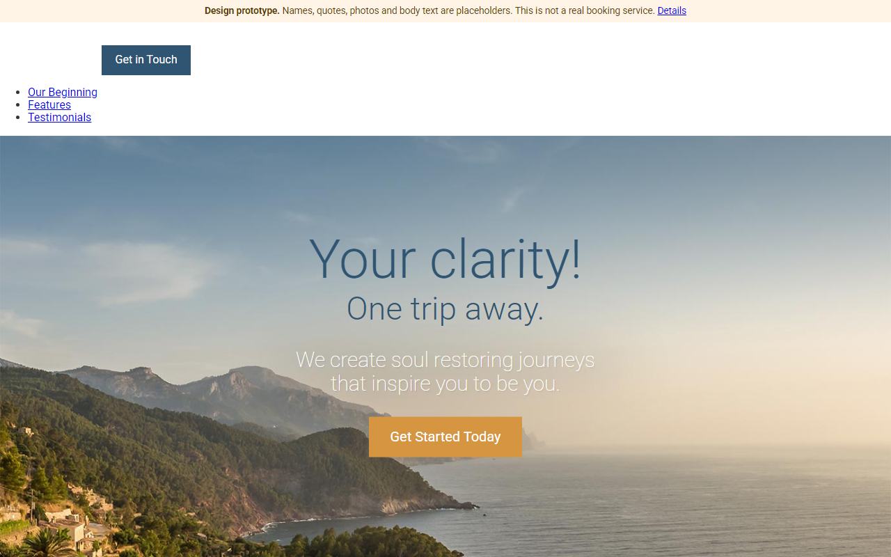

# Clear View Escapes: travel landing page (static prototype)

A one-page travel landing page with a responsive hero image. It is a **front-end design prototype**, not a
working travel product: there is no search, booking, sign-in, app or backend behind it.

**Product owner:** Bhawna Mangla · **Built with AI** (Claude), for the documentation and fixes in this repo · **Status:** prototype

| | |
|---|---|
| **Open the page** | https://bhawnamanglapm.github.io/travel-site/ (published by GitHub Actions after the first merge to `main`) |
| **Design mock-up** | [`design-hifi.png`](design-hifi.png) |



## What this shows, and what it doesn't

**Shows (observable in the code):**
- A responsive hero: four image sizes, each with a high-resolution variant, chosen with `<picture>` and `srcset`.
- Mobile-first CSS written in BEM naming, split into base and module files, with PostCSS (imports, nesting, mixins, variables).
- A Webpack 4 build that bundles the CSS.

**Does not show:**
- Any user research, target audience, problem statement or measured result. None is recorded in this repo.
- Search, booking, payments, accounts, an app, or a contact channel. The "Get in Touch" and "Get Started Today" buttons only jump to a note saying so.
- A finished design. Only the header, hero and buttons are styled. The "Our Beginning", "Feature ideas" and "Testimonials" sections are unstyled.

All text below the hero is placeholder: lorem ipsum, the names Jane Doe, John Smith and Cat McKitty, and the
four "feature ideas" (weather alerts, global guides, Wi-Fi waypoints, a survival kit) are concepts that were
never built. The page labels this itself.

## Owner input needed (not recorded anywhere I can verify)

- Whether this began as a course or tutorial exercise or as your own concept. This README does not claim either.
- Where the photos and the founder and testimonial portraits come from, and whether you may reuse them. Until
  that is known, treat the images as unverified licensing.
- The problem this would solve and for whom. Without that, it can only be presented as a front-end sample.

## What has been checked

| Check | Result | How |
|---|---|---|
| Page builds | Pass locally (Node 24) | `npm run build`; the CI run on Node 20 is shown on the pull request |
| All 26 referenced local files exist; images have `alt`; no dead `#` links; placeholder content is labeled | Pass (12 checks) | `npm test`, also run on every push and pull request |
| Page loads with no console errors or failed requests; no sideways scrolling at 1280 px and 375 px | Pass | Headless browser on a local copy, 2026-10-18 |
| Looks right in other browsers; accessibility audit; performance | Not checked | |

## Run it

Needs Node.js 18 or later.

```bash
npm ci
npm run dev     # dev server at http://localhost:3000
npm run build   # production bundle into app/bundled.js
npm test        # offline checks
```

`npm run build` and `npm run dev` use Webpack 4. On Node 17 and later it needs OpenSSL's legacy provider;
`npm run build` sets that for you. If `npm run dev` fails with `ERR_OSSL_EVP_UNSUPPORTED`, run it as
`NODE_OPTIONS=--openssl-legacy-provider npm run dev` (on Windows PowerShell: `$env:NODE_OPTIONS="--openssl-legacy-provider"; npm run dev`).

## Files

| Path | What it is |
|---|---|
| `app/index.html` | The page |
| `app/assets/styles/` | CSS: base, hero, buttons and the prototype note |
| `app/assets/images/` | Photos, portraits and icons (origin unverified, see above) |
| `app/bundled.js` | Built bundle (committed so the page works as is) |
| `design-hifi.png` | High-fidelity design mock-up |
| `photoshop-source.psd` | 92 MB Photoshop source. It makes the repo history about 160 MB; it was not removed |
| `scripts/` | Build wrapper and offline checks |
| `.github/workflows/ci.yml` | Builds, tests, and publishes `app/` to GitHub Pages from `master` |

## Known gaps

- The header logo does not show in the desktop screenshot above, and the header and nav are unstyled.
- The Webpack 4 toolchain is old and its dependencies have known deprecation warnings. It was not upgraded.

## License

The repo declares ISC in `package.json` but has no LICENSE file. Image rights are unknown (see above).
